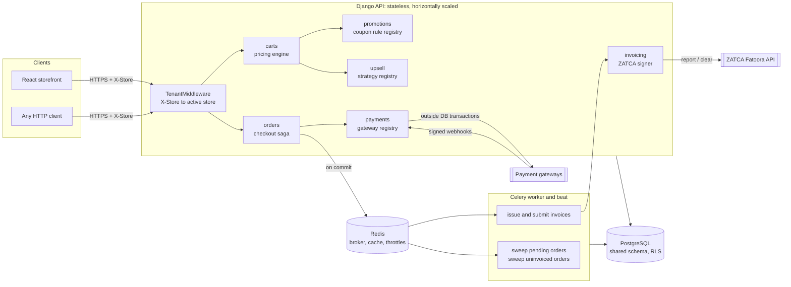
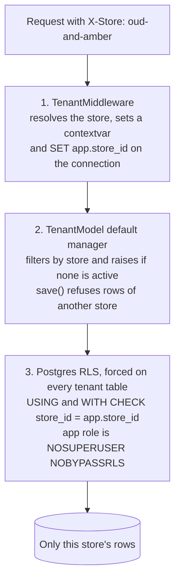
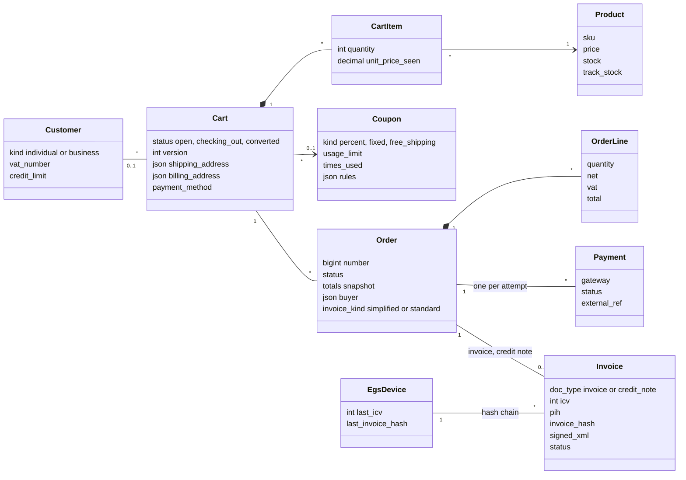
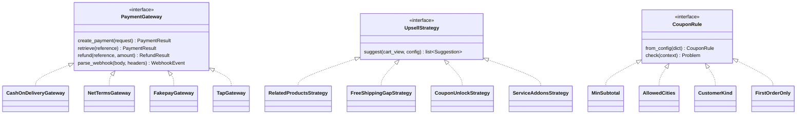
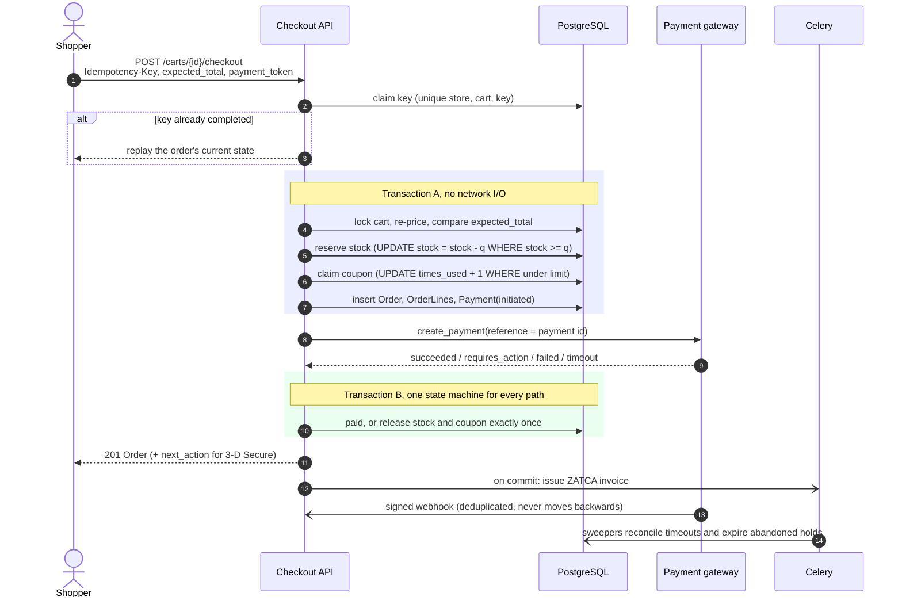

# E-commerce Platform

A multi-tenant cart system for thousands of stores running in one deployment and one database. It covers
cart management, checkout with pluggable payment gateways, pluggable upselling, coupon constraints, B2B
orders and ZATCA Phase 2 e-invoicing. The backend is Django 6.1 and the demo storefront is React.

- **Design write-up and trade-offs:** [docs/DESIGN.md](docs/DESIGN.md)
- **API conventions, error codes and a curl walkthrough:** [docs/API.md](docs/API.md)
- **OpenAPI 3 schema:** [backend/openapi.yaml](backend/openapi.yaml), served as Swagger UI at `/api/v1/docs`

## Quick start

```bash
make up            # Postgres 18, Redis 7, API, Celery worker and beat, storefront
make seed          # two demo stores, products, coupons, customers, e-invoicing devices
make demo          # end-to-end walkthrough against the running API
```

| What | Where |
|---|---|
| Storefront | http://localhost:5180 |
| Swagger UI | http://localhost:8100/api/v1/docs |
| Demo login | `sara@example.com` (B2C) or `procurement@acme.example.com` (B2B), password `demo-pass-123` |
| Sandbox cards | `tok_success`, `tok_3ds`, `tok_decline`, `tok_insufficient_funds`, `tok_timeout` |

Every API call names its tenant in the `X-Store` header: `oud-and-amber` (B2C, VAT-inclusive prices) or
`riyadh-office-supply` (B2B, VAT-exclusive prices, pay on invoice).

## What the brief asked for

| Requirement | Where it lives |
|---|---|
| Single database, tenant isolation | `apps/tenancy`: request scoping, fail-closed managers, Postgres row-level security |
| Add/remove product, add/remove coupon, address, payment method, checkout | `apps/carts`, `apps/orders/checkout.py` |
| Pluggable payments | `apps/payments`: one gateway interface; COD, net terms, a 3-D Secure sandbox and a Tap adapter |
| Pluggable upselling | `apps/upsell`: strategies configured per store |
| ZATCA invoices | `apps/invoicing`: UBL 2.1, XAdES signature, QR, hash chain, reporting and clearance |
| Coupon constraints (bonus) | `apps/promotions/rules.py`: min subtotal, cities, customer kind, first order |
| B2B orders (bonus) | Business accounts, credit limits, PO numbers, standard tax invoices cleared by ZATCA |
| Race conditions, docs, tests | 147 backend tests (94% coverage) including threaded tests against real Postgres |

## Architecture

### Components



- **PostgreSQL** is the system of record for money, stock and coupon counters. Every table it guards is protected by
  row locks, constraints and row-level security.
- **Redis** is only a broker, cache and throttle store. If it fails, checkout keeps working and the sweepers catch up.

### Tenant isolation



A forgotten filter fails loudly in layer 2. A raw query that slips past the ORM still sees nothing in layer 3. A
cart, order or product id from another store returns 404 on every endpoint.

### Domain model



Every class above extends `TenantModel` (a UUIDv7 key, `store_id`, a fail-closed manager and an RLS policy), so
none of them can be read or written outside the active store. `Store` is the only global domain table.

### Plug-in points



Each family has a registry in settings and per-store configuration. Adding a gateway means writing one class and
registering it; the checkout saga, webhooks and reconciliation do not change.

### Checkout



## API at a glance

| Method | Path | Purpose |
|---|---|---|
| POST | `/api/v1/auth/token` | Store-scoped customer sign-in |
| GET | `/api/v1/store`, `/api/v1/products`, `/api/v1/payment-methods` | Store settings and catalogue |
| POST | `/api/v1/carts` | Open a cart (guest carts get a `cart_token`) |
| GET | `/api/v1/carts/{id}` | Cart with live totals, warnings and `checkout_readiness` |
| POST, PATCH, DELETE | `/api/v1/carts/{id}/items[/{item_id}]` | Add, change and remove products |
| PUT, DELETE | `/api/v1/carts/{id}/coupon` | Apply or remove a coupon |
| PUT | `/api/v1/carts/{id}/shipping-address`, `/billing-address` | Saudi national address; VAT number for B2B |
| PUT | `/api/v1/carts/{id}/payment-method` | Choose how to pay |
| GET | `/api/v1/carts/{id}/suggestions` | Upsell and cross-sell |
| POST | `/api/v1/carts/{id}/checkout` | Place the order (requires `Idempotency-Key`) |
| GET, POST | `/api/v1/orders/{id}`, `/payment/confirm`, `/invoice` | Order, 3-D Secure return, ZATCA invoice |
| POST | `/api/v1/webhooks/payments/{gateway}/{store}` | Signed gateway callbacks |

Errors are RFC 9457 problem documents with a stable `code`. Cart writes accept `If-Match` and return 412 when stale.
Money is always a decimal string. Details are in [docs/API.md](docs/API.md).

## Testing

```bash
make test          # pytest on real Postgres as the restricted app role
make lint          # ruff
make web-check     # storefront typecheck, lint, tests, build
make zatca-check   # validate a simplified and a standard invoice against ZATCA's developer portal
```

The suite covers:
- tenant isolation at every layer, including every endpoint called from another store;
- a property test that cart totals always satisfy ZATCA's VAT arithmetic;
- threaded race tests against Postgres: the last unit of stock, a single-use coupon, the same and different
  idempotency keys, concurrent cart edits, and a gapless invoice hash chain under concurrent issuance;
- a contract test that every payment gateway passes;
- webhook signature, duplicate and out-of-order delivery;
- ZATCA signing, QR and the submission classifier.

`make zatca-check` sends dummy invoices to ZATCA's public sandbox: the simplified one comes back REPORTED, the
standard one CLEARED, with no warnings.

## Repository layout

```
backend/
  config/            settings, URLs, Celery
  apps/tenancy/      stores, tenant context, middleware, RLS migrations
  apps/catalog/      products and merchant recommendations
  apps/customers/    customers and store-scoped tokens
  apps/carts/        cart API, pricing engine
  apps/promotions/   coupons and constraint rules
  apps/orders/       checkout saga, order lifecycle, sweepers
  apps/payments/     gateway interface, gateways, webhooks, 3-D Secure sandbox
  apps/upsell/       strategy interface and engine
  apps/invoicing/    ZATCA UBL builder, signer, QR, client, tasks
  apps/common/       errors, money, idempotency, OpenAPI helpers
  scripts/demo.py    end-to-end walkthrough
web/                 React storefront
docs/                design write-up and API guide
```
