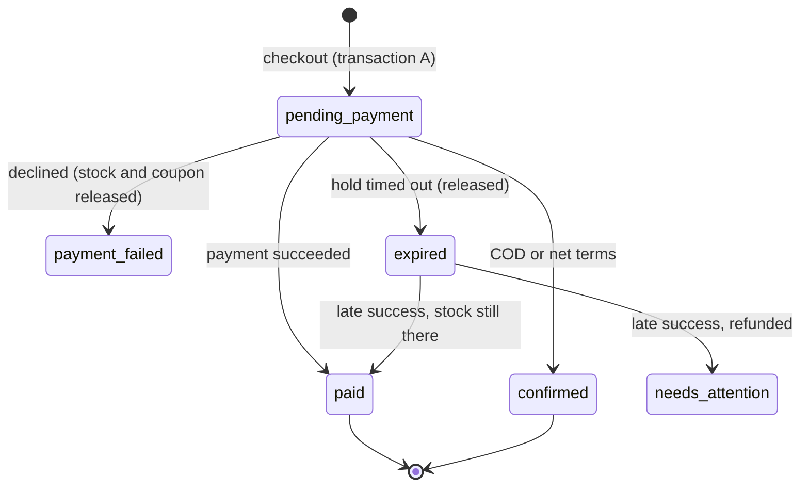
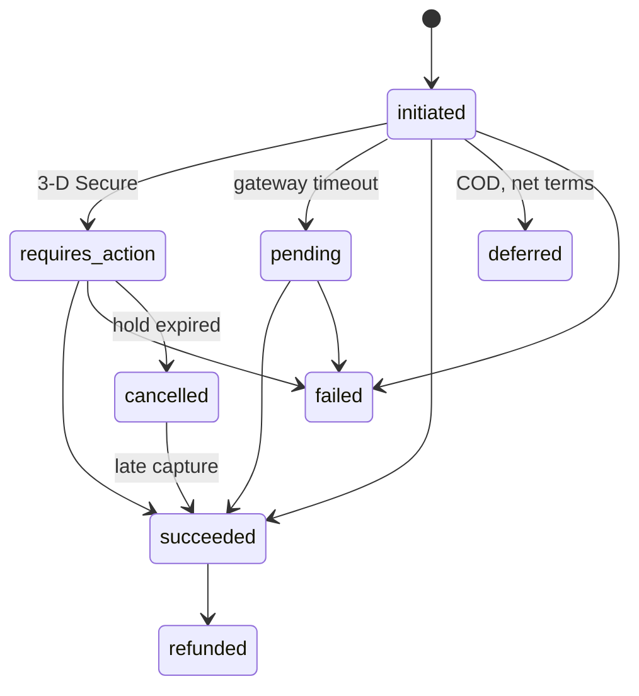

# Design and trade-offs

The brief: a cart for thousands of stores in one deployment, where an outage is lost money. That framed three
priorities, in order:

1. **Never charge wrongly:** no double charges, no overselling, no total the shopper did not see.
2. **Never leak across tenants.**
3. **Keep selling when something around the cart fails:** the gateway, ZATCA, Redis, a recommender.

Every decision below traces back to one of those.

## 1. Data stores

| Store | Role | Why |
|---|---|---|
| PostgreSQL 18 | System of record for everything | See below |
| Redis 7 | Celery broker, cache, per-store throttles | Fast and disposable. Nothing in it is the only copy of anything. |

**Why PostgreSQL:**
- ACID transactions and row locks.
- Constraints that enforce invariants under concurrency: `CHECK (stock >= 0)`, `times_used <= usage_limit`, partial
  unique indexes such as "one active cart per customer" and "one pending order per cart".
- Row-level security for tenancy.
- JSONB for coupon rules, addresses and per-store config.
- One mature engine instead of several.

**Why counters are not in Redis:** stock and coupon counters would be faster as Redis `DECR`. But they would then need
reconciliation with the database, and Redis would become a second source of truth for money. Contention is bounded
instead by keeping the locking transaction short and never doing network I/O inside it.

**Why Redis as the broker:** RabbitMQ or SQS would give stronger delivery guarantees. Here they are not needed,
because the database is the safety net:
- tasks are idempotent, with `acks_late`;
- enqueueing uses `on_commit(..., robust=True)`, so a broker outage cannot fail a paid checkout;
- beat sweepers re-drive anything a lost message left behind.

A transactional outbox is the next step if the sweep interval ever becomes too slow.

## 2. Tenancy: shared schema, three layers

The brief requires one database. **Schema-per-tenant was rejected:** thousands of schemas means thousands of migration
runs per deploy and catalog bloat. **Shared tables with `store_id` everywhere were chosen**, and every key and unique
constraint leads with `store_id`.

| Layer | Mechanism | What it catches |
|---|---|---|
| Request | `X-Store` resolves the store, which goes into a contextvar and `SET app.store_id` on the connection | Every request has exactly one tenant |
| ORM | `TenantModel` manager filters by store and **raises** when none is active; `save()` rejects foreign rows | A forgotten filter fails loudly instead of leaking |
| Database | `FORCE ROW LEVEL SECURITY`, `USING` and `WITH CHECK` on `store_id`; app role is `NOBYPASSRLS` | Raw SQL, a bad join, a future bug in layers 1 and 2 |

Details that matter:
- **Stale tenant on pooled connections:** the setting is reset after every request and Celery task, and re-applied on
  reconnect.
- **The bypass cannot leak:** `rls_bypass()` uses a transaction-local setting. Only the sweepers use it, to discover
  ids across stores; each store is then processed in its own context.
- **No existence leak:** a foreign id returns 404, never 403.
- **Cross-store tokens fail:** customer tokens are scoped to a store, so another store's token gets 401.
- **Tested from the API:** a test calls every resource from another store and expects 404.
- **The tests can't pass by accident:** another test asserts the database role cannot bypass RLS. Otherwise the RLS
  tests could pass for the wrong reason.

**Threat model:** RLS protects against application bugs, not a compromised application, because the application can
set the GUC itself. Defending against that needs a connection proxy that sets the tenant from a verified identity.

**Noisy neighbours:** per-store throttles, a statement timeout, and a lock timeout that turns contention into a
retryable `409 RESOURCE_BUSY` instead of a stuck worker.

## 3. API style

**Why REST (DRF + drf-spectacular):** idempotency keys, conditional requests and status codes are first-class HTTP
features, and they are exactly what checkout needs. Conventions:

- Resources are nouns; actions that are not CRUD are explicit sub-resources: `/checkout`, `/payment/confirm`.
- Every cart write returns the whole cart, so clients never need a follow-up GET.
- The cart reports `checkout_readiness.missing` and `warnings` (price changed, item unavailable, coupon no longer
  applies) instead of silently changing what the shopper saw.
- Errors are RFC 9457 problem documents with a stable `code`, plus the data a client needs (`remaining`,
  `available`, `current_version`).
- Status codes carry meaning:

  | Code | Meaning |
  |---|---|
  | 400 | Malformed request |
  | 409 | State conflict |
  | 412 | Stale `If-Match` |
  | 422 | Rule violation |
  | 428 | Missing `Idempotency-Key` |

- Every error, warning and suggestion carries a stable code plus its data (`remaining`, `available`, `reason`), so a
  client can localise without parsing English. The storefront ships English and Arabic this way.
- Money is a decimal string. VAT basis is explicit (`prices_include_vat`), and each line carries `net`, `vat` and
  `total`.

## 4. Concurrency

**Global lock order:** cart, then order, then payment, then products (by id), then coupon, then customer, then
e-invoicing device. Every code path uses the same order, so deadlocks cannot form.

| Race | Mechanism |
|---|---|
| Two writes to one cart | Row lock plus `version`; optional `If-Match` returns 412 instead of a lost update |
| Last unit of stock | `UPDATE ... SET stock = stock - q WHERE stock >= q` at checkout, in product-id order |
| Single-use coupon | `UPDATE ... WHERE usage_limit IS NULL OR times_used < usage_limit`; per-customer count after that lock |
| Double-click, retries | `Idempotency-Key` scoped to store and cart, fingerprinted on the body; in flight 409, replay, reuse 422 |
| Charge twice | Gateway idempotency key is our Payment id; `unique(store, gateway, external_ref)` |
| Duplicate or late webhooks | `unique(event_id)`; the payment state machine never moves backwards |
| Gateway timeout | Payment stays pending; the sweeper calls `retrieve()` and settles it |
| Payment after hold expiry | Re-reserve stock and honour it, or refund automatically and flag `needs_attention` |
| B2B credit limit | Customer row lock, then outstanding amount computed inside the transaction |
| Invoice counter | Device row lock; `unique(device, icv)` and `unique(order, doc_type)` |

All of these have threaded tests against real Postgres, repeated to rule out flakes.

**Stock is reserved at checkout, not when added to the cart.** Reserving early lets carts hoard inventory and needs
TTL cleanup on every cart. The cost is that a shopper can lose the last unit between the cart and paying; the API
reports that precisely (`409 OUT_OF_STOCK` with `available`).

**Order numbers use a global sequence, not a per-store counter.** A per-store counter would serialise every checkout
in a store on one row. Order numbers do not need to be gapless; ZATCA's invoice counter does, and that is the only
per-store serialisation point.

### Order and payment states

## 5. Money and VAT

The pricing engine is a pure function. **VAT is computed once at document level and allocated to lines by largest
remainder.** This guarantees that line totals, the cart total, the amount charged and the invoice's `PayableAmount`
are identical to the halala.

For VAT-inclusive stores, net is derived from the charged gross, so the shopper pays exactly the displayed price.

A hypothesis test checks ZATCA's arithmetic rules (BR-CO-15, BR-CO-17 within one halala, BR-KSA-51) on random carts.

On the invoice, a line whose net does not divide evenly by quantity is split into two lines (for example 2 × 86.95
and 1 × 86.96), so `quantity × price = line amount` always holds.

**Shipping is limited to Saudi addresses.** That keeps every supply standard-rated; exports would need zero-rated
categories with exemption reasons.

## 6. Pluggable payments and upsell

**Payments.** One `PaymentGateway` interface: `create_payment`, `retrieve`, `refund`, `parse_webhook`.
- Gateways normalise their own statuses; nothing outside a gateway sees provider JSON.
- A shared contract test runs against every gateway.
- Shipped gateways:
  - cash on delivery;
  - net terms (approved business accounts, credit-limited);
  - fakepay, a sandbox with deterministic tokens, a hosted 3-D Secure page and signed webhooks;
  - a Tap adapter.
- Webhooks use a per-store URL, so the signature is verified with that store's secret without bypassing tenancy.
- The 3-D Secure return also calls `retrieve()`, so a missing webhook never strands an order.

**Upsell.** Strategies are pure functions of the cart view, configured and ordered per store: related products,
free-shipping gap, coupon unlock (advertised coupons only) and service add-ons. The engine catches every exception
and enforces a time budget. **Upsell is best-effort by design:** it can degrade to nothing, never to an error.

## 7. ZATCA

Written from the specification and checked against ZATCA itself:

- **Issuing.** After payment, one short transaction locks the store's e-invoicing device, takes the next counter
  (ICV) and the previous invoice hash (PIH), builds UBL 2.1 from the order snapshot, signs it and stores it.
  Reporting and clearance run in a separate retried task, so ZATCA latency never sits inside a lock.
- **Signing.**
  - The hash is SHA-256 over the C14N of the document, with the extensions, signature and QR removed.
  - The stamp is ECDSA secp256k1 over the decoded hash.
  - The XAdES digests are base64 of the hex digest.
  - The signature is spliced into the canonical XML, and the result is re-hashed before storage.
  - The QR is TLV tags 1 to 9.
- **B2C vs B2B.** B2C gets simplified invoices that are reported within 24 hours. B2B gets standard invoices with the
  buyer's VAT number and national address; they are cleared before the buyer can see them.
- **Failure handling.** 5xx, 429 and HTML responses are retried. Parsed 4xx responses are marked rejected.
  `NOT_REPORTED` counts as a failure. Signed invoices are immutable; corrections are credit notes that reference the
  original and wait until it is accepted.
- **Validation.** `make zatca-check` onboards a throwaway device on ZATCA's developer portal and submits a simplified
  and a standard invoice built by this code. Both pass with no warnings.

ZATCA being down never blocks checkout. The order is placed and the invoice waits in `pending_retry` well inside the
24-hour reporting window. Standard invoices wait for clearance before they are shown.

## 8. B2B

**What exists:**
- business accounts with VAT and CR numbers, an approval flag and a credit limit;
- pay on invoice (net terms) as a payment gateway, so it reuses the whole checkout saga;
- PO numbers carried into the UBL `OrderReference`;
- VAT-exclusive price display.

**What a real B2B rollout would add:** price lists per customer group, quantity breaks, multi-user company accounts
with approval flows, and quotes.

## 9. Failure modes

| Failure | Behaviour |
|---|---|
| Gateway timeout | Order stays `pending_payment`; the sweeper reconciles through `retrieve()`; never retried blindly |
| Gateway down | Checkout returns the pending order; nothing is charged twice when it recovers |
| Webhook lost | 3-D Secure return and the sweeper both settle the payment |
| Redis down | Throttles and cache fail open; enqueue failures are swallowed after commit; sweepers re-drive work |
| Worker crash mid-task | `acks_late` redelivers; every task is idempotent |
| ZATCA down | Invoice waits in `pending_retry`; checkout unaffected |
| Recommender slow or broken | Suggestions shrink to what finished inside the budget |
| Hot row (flash-sale coupon) | Lock timeout returns `409 RESOURCE_BUSY` with `Retry-After` instead of tying up workers |
| Database | The real single point of failure: primary with synchronous replica and automatic failover |

`/readyz` checks only the database, so a Redis blip does not pull every pod out of rotation.

## 10. What I would do next

- **Transactional outbox** for invoice and webhook events, replacing sweep-based recovery.
- **Composite foreign keys** `(store_id, id)`, so the database also rejects cross-store references.
- **Partitioning by `store_id`**, or Citus with `store_id` as the distribution column; the schema is already shaped
  for it.
- **A Django admin** on a separate BYPASSRLS database role, with audit logging.
- **Production Fatoora onboarding** (production CSID), plus key storage in a KMS instead of the database.
- **Abandoned-cart cleanup**, customer cart merge on sign-in, and multi-currency.
- **Observability:** RED metrics per store, alerts on `needs_attention` orders and rejected invoices.
